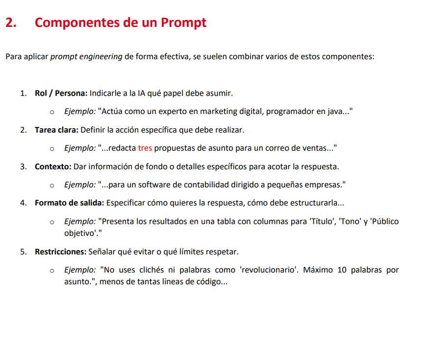

# Prompts-Apuntes

Los prompts deben de tener un estructura para mejorar la eficacía.

En general deben de seguir estas 5 cosas:

- Para un buen prompt es importatne que seamos directos y claros
- En el contexto no hay que enrearse tanto
